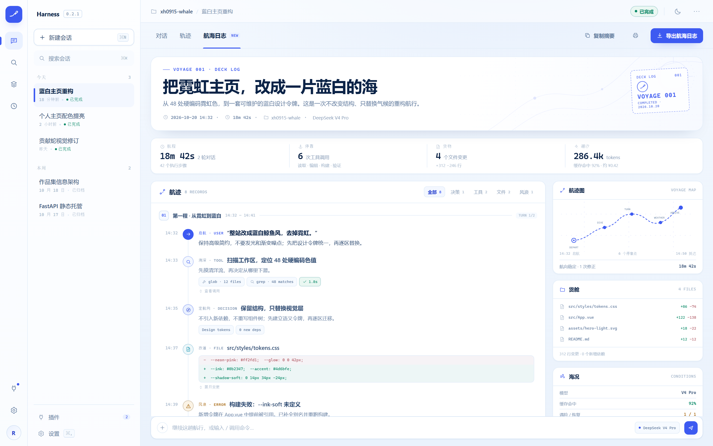

# Voyage Log · dsh-voyage-log

[中文](README.md) · **English**

A DeepSeek Harness tab plugin that **turns one AI session into a report you can actually read.**

One conversation is one voyage. When a long session ends in DSH it is hard to say what actually happened: which files changed, how many tool calls ran, which step failed, how many tokens went in. All of it is already in the session log, but nobody wants to read raw events. Voyage Log reads them for you and lays the trip out on a few pages.



*Design mockup, not a capture of the shipped tab. The rendered UI depends on your Harness.*

## What you see once installed

Any conversation with history gets a **Voyage Log** tab at the top. It has three sections:

### Key numbers

The scorecard for the trip: wall time, turns, tool calls, failed calls, files changed and read, and tokens (input, output and cache-read counted separately).

Every number is measured off the log. Nothing is estimated, and there is no cost figure — the log does not carry one, so the plugin will not invent it.

### Timeline

Turn by turn, in order: your prompt, the reply, each tool call with its duration and result, approvals with their outcome, retries, context compactions, and how the turn ended.

A tool call that never received a result is shown as exactly that, instead of silently disappearing.

### Files, tools and models

Leaderboards for files and tools: which files were edited, written and read the most, which tools were called and failed the most, and how many replies each model produced.

### Also

- **Task list** — the latest todo board written in the session.
- **Export** — copy a Markdown digest, or download / print a **single HTML file** with inline styles, no external assets and no scripts. It opens anywhere.

## Privacy: it will not leak your keys

Sessions often carry keys, tokens and email addresses. Everything is cleaned up *before* it reaches the UI:

- Reading and folding happen **on your machine**; nothing is uploaded.
- Private key blocks, JWTs, GitHub / AWS / Google / Slack / npm / PyPI / Stripe / DeepSeek-shaped keys, `Bearer` headers, credentials inside URLs, `api_key = …` assignments and email addresses are replaced with `«已脱敏»`.
- The report states how many spans were masked and which families fired.
- Things that merely look secret are left alone: `process.env.X`, `${TEMPLATE}`, `foo.bar.baz`, `ALL_CAPS_CONSTANTS` and short strings.
- Redaction is on by default. Turn it off and the report says so, instead of pretending it ran.

## Install

Requires Node.js 22.19+ (or 24+) and DeepSeek Harness 0.1.0-rc.6+.

```sh
git clone https://github.com/xh0915/dsh-voyage-log
cd dsh-voyage-log
pnpm install
pnpm run build
dsh plugin --profile web add .
```

Restart the Web Harness. Open any conversation with history and the tab is there.

**`pnpm run build` must run before `add`.** The package ships no install-time build script (pnpm 10 blocks unapproved `prepare` scripts); skip this step and the plugin installs but fails to load.

Remove it with:

```sh
dsh plugin --profile web remove dsh-voyage-log
```

## Settings

```yaml
dsh-voyage-log:
  redactSecrets: true   # mask secrets before they reach the UI (default)
  maxTurnEvents: 240    # rows per turn, 20–5000
```

When a very long turn overflows the budget, key rows are kept first, the turn is marked `capped`, and the report carries a truncation note — nothing disappears silently.

## Boundaries

- **No cost figure**: the log has no price, so the plugin does not guess one.
- **No streaming noise**: `*-chunks` incremental events are ignored by design; only events that describe the trip are read.
- **Nothing extra is fetched**: data comes from Harness's own `sessionQuery` — the same session you can already see.
- The UI follows Harness light and dark themes.

## Technical details

<details>
<summary>For people changing the code</summary>

### Layout

```text
package.json           # dsh.bundle.patch + dsh.client, scripts, peer deps
cordis.patch.yml       # mounts the host plugin row into a profile
dsh.plugin.json        # registry manifest
src/index.ts           # host entry: Config schema, Remote service, Typert manifest
src/runtime.ts         # voyage.build(sessionId) — reads the log, groups it, returns
src/fold.ts            # the grouping engine: raw events -> turns, rows, totals
src/redact.ts          # local secret redaction
src/schema.ts          # Zod wire authority (types inferred, nothing drifts)
src/contract.ts        # strict InvocationDescriptor shared by host and client
src/typert.ts          # host reflection manifest
src/client/index.tsx   # client entry: mounts the Remote, registers the tab
src/client/view.tsx    # the voyage view
src/client/report.ts   # Markdown digest + self-contained HTML report
src/client/styles.ts   # theme-token stylesheet (follows Harness light/dark)
src/client/locales.ts  # zh / en copy
tests/                 # fold, redaction, contract, and report unit tests
build.mjs              # esbuild dual build: host ESM + client CJS
```

The client half contributes **no** prompt, tool, or session event — `ctx.typert.register()` only publishes reflection metadata. The plugin is UI over your own data.

### Development

```sh
pnpm run check   # typecheck + lint + test + build
```

### Renaming

If you fork this and rename it, keep these in sync: `package.json` → `name`, `exports`, `files`; `build.mjs` → the `__ModuleLoader__.load` id; `src/index.ts` → `name`; `src/client/remote.ts` → the hex-encoded `TypertRemoteNamespace$…` name; `src/client/locales.ts` → the locale namespace; `src/client/index.tsx` → the slot id; `src/typert.ts` → `package`; `src/contract.ts` → the invocation id; `cordis.patch.yml` → `id` and `name`; `dsh.plugin.json` → `id`.

</details>

## License

MIT

Built by [里卡多 / xh0915](https://xh0915.github.io)
